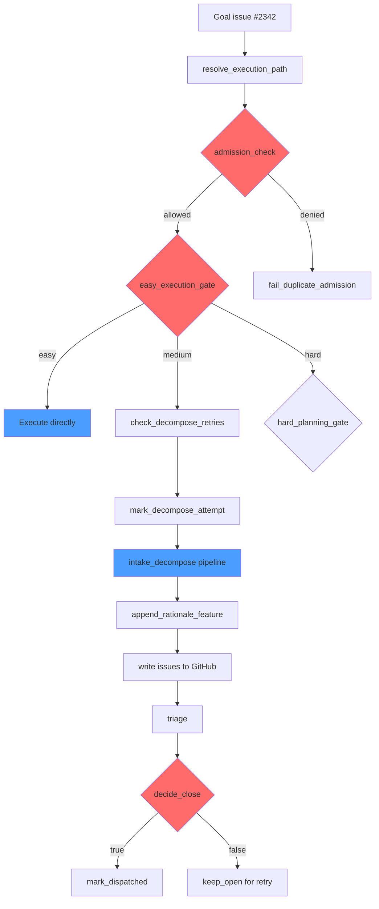
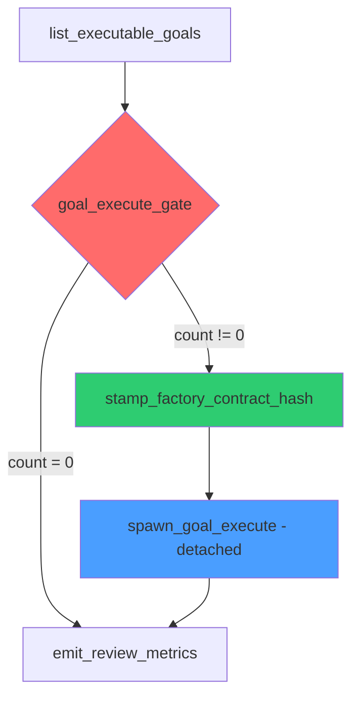
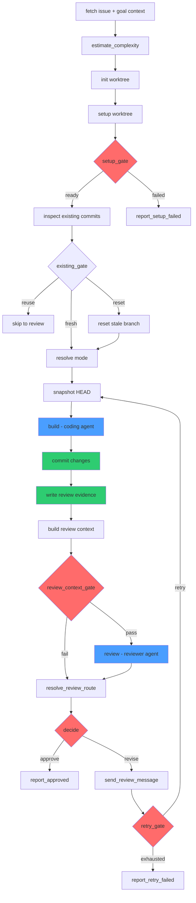
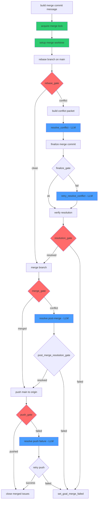

# Goal Lifecycle Walkthrough

This document describes the current shipped goal path. Some lifecycle ownership
details here are now explicit design debt. See
[Canonical Issue Lifecycle](./architecture/canonical-issue-lifecycle.md) for
the target design where Postgres owns lifecycle truth and GitHub is only a
projection target.

## Overview

A "goal" is the atomic unit of work the Astrochicken factory accepts. When a GitHub issue labeled `goal` and `ready` appears, a deterministic supervisor pipeline decomposes it into sub-issues, dispatches coding agents in isolated git worktrees, subjects each implementation to independent review, merges passing work to `main`, and closes the goal once all sub-issues are done. Every transition is gated by a deterministic check, and every LLM decision is bounded by retry budgets and fallback paths. This document traces that lifecycle end-to-end using a real goal.

## The Goal

**Goal #2342: Make worktree/langfuse tests hermetic to /tmp fixture state**

```
Created: 2026-03-18T18:12:17Z
Closed:  2026-03-18T19:42:35Z
Labels:  [goal, ready]
```

The problem: several `apps/hatch` handler tests relied on hardcoded `/tmp/` paths without creating the required filesystem structure. A recent worktree lock change exposed the coupling, causing `StageStatus.Failed` outcomes that looked like model/provider regressions.

The goal asked for hermetic test fixtures scoped to `mkdtemp` so tests could run without ambient filesystem state.

The factory decomposed this into three sub-issues:

| # | Issue | Status |
|---|-------|--------|
| #2343 | Add hermetic worktree fixture helpers for handler tests | Closed |
| #2344 | Hermeticize worktree/langfuse tests with temp fixture helper | Closed |
| #2346 | Add regression coverage proving worktree lock fixtures are created per test | Closed |

Time from goal creation to all code merged: **~90 minutes**.

## Phase 1: Admission and Decomposition

When the supervisor tick fires, it discovers goal #2342 in the ready queue and routes it through the `goal_run.dot` pipeline.

### The Pipeline



### Execution-path classification

Before decomposition begins, `resolve_execution_path` classifies the goal as `easy`, `medium`, or `hard`:

- **easy**: The goal is small enough that a single coding agent can implement it directly, without decomposition. The factory spawns `goal_execute.dot` inline and skips issue creation entirely.
- **medium**: Standard decomposition. The LLM analyzes the codebase, proposes feature sub-issues, a reviewer LLM approves or revises the proposal, and issues are created on GitHub.
- **hard**: The goal requires a multi-step planning hold. The factory creates a planning artifact, optionally waits for human review, and materializes approved plans into issues.

Goal #2342 was classified as `medium` -- standard decomposition.

### Decomposition: analyze, propose, review

The `goal_intake_decompose.dot` pipeline runs three LLM stages in a shared session (so codebase exploration persists across steps):

1. **Analyze** (`goal_decomposer` role): Fetches the goal issue, scans the code inventory (`find apps/hatch/src ... | head -160`), loads the intent stack, and produces a structured `goal_context` JSON describing the problem space, affected files, and constraints.

2. **Propose** (`goal_decomposer` role): Takes the goal context and proposes a feature breakdown. Each feature gets a title, description, acceptance criteria, and optional `blocked_by` dependency edges. The output is a JSON array of feature objects.

3. **Review** (`goal_decomposer` role): An independent review pass (same session but a separate system prompt) evaluates whether the proposed features collectively satisfy the goal. It can approve, revise with notes (triggering a re-proposal), or reject. The retry budget is 2 revisions before falling back to the best available proposal.

For #2342, the decomposer proposed three features and the reviewer approved on the first pass.

### Issue creation

The `write_issues.dot` pipeline fans out over the approved features and creates GitHub issues. Each issue includes:

- A structured body with summary, implementation plan, acceptance criteria, and scope constraints
- `blocked_by` references to sibling issues (topologically ordered later)
- A parent relationship linking back to the goal

After issue creation, `triage.dot` validates the issues are well-formed, then the goal is marked `dispatched` -- its `ready` label stays, but a machine-readable comment records the decomposition state.

### Admission guards

Several deterministic gates protect against pathological states:

- **Duplicate decomposition guard**: If a decomposition packet already exists for this goal, the admission check rejects the second attempt. This prevents re-decomposition if the supervisor tick re-fires.
- **Decompose retry budget**: Maximum 3 decompose attempts across ticks. After exhaustion, the goal is labeled and the supervisor is notified.
- **Backpressure**: `goal_decompose_backpressure` checks whether too many goals are already in-flight before admitting new decompositions. The `max_concurrent_goals` config (default: 3) controls this.

## Phase 2: Goal Execution Dispatch

After decomposition, the goal enters the execution queue. On the next supervisor tick (or later in the same tick), the supervisor's `list_executable_goals` step finds goals with open sub-issues and spawns `goal_execute.dot` as a detached process.



Key details:

- **Detached spawn** (`fan_out.detached`): Goal execution runs as a separate process, not blocking the supervisor tick. This lets the supervisor continue monitoring, ingesting artifacts, and processing other goals.
- **Contract hash stamp**: Before spawning, the factory stamps a hash of its own contract files. This enables drift detection -- if the factory's graphs or configs change mid-execution, the stamp provides traceability.
- **Capacity gating**: `max_concurrent_waves` (default: 5) limits total in-flight goal executions. Active runs are deduped against the runs directory.

## Phase 3: Coding Agent Execution

The `goal_execute.dot` pipeline processes sub-issues sequentially, following a topological sort of `blocked_by` dependencies established during decomposition.

### Execution plan

At startup, `build_execution_plan` constructs a toposort of the goal's sub-issues. This order is **invariant for the entire run** -- even if issues close during execution, the plan does not re-order. Issues already closed (from prior runs) are seeded into the completed set and skipped.

### Per-issue execution

For each sub-issue, `goal_issue_execute.dot` runs:



### Worktree isolation

Each goal gets a **shared goal-scoped branch** (e.g., `goal/2342`). Sub-issues execute sequentially in the same worktree, committing to the shared branch. This matters because:

- **Workspace isolation**: The coding agent works in a `git worktree add --detach` checkout, completely separate from the canonical `main` checkout. The agent cannot accidentally modify files in the main working tree.
- **Toolchain linking**: `ensure_toolchain` symlinks `node_modules` and other workspace scaffolding into the worktree so the agent has a working build environment without running a full `pnpm install`.
- **Branch scope**: All sub-issues for one goal commit to the same branch. This means sibling issues share code, and the scope discipline instruction in the builder prompt constrains agents to only modify files required by their specific issue.

### The builder

The `build` node is a `coder`-class LLM node. It receives:

- The issue body and title
- The parent goal context (for alignment, not full implementation)
- The intent stack (platform and factory-level objectives)
- AGENTS.md and AGENT-LEARNINGS.md excerpts (repo governance and proven lessons)
- Complexity estimate from the `estimate_complexity` step
- Any reviewer notes from a previous revision pass

The builder's commit message must include `Closes #<issue_number>` so GitHub auto-closes the issue on merge.

**Scope discipline** is enforced by prompt contract: the builder must only modify files directly required by the current issue's acceptance criteria. If a pre-commit test fails on code the builder did not write, the builder reports it in `BUILDER_NOTES` rather than modifying unrelated code.

### The information wall

The builder and reviewer operate with different views of the system:

| | Builder | Reviewer |
|---|---------|----------|
| Source code | Full worktree access | Full worktree access |
| Issue context | Current issue + parent goal | Current issue + parent goal |
| Scenarios | Not visible | Visible via scenario registry |
| Builder notes | Produces them | Consumes them |
| Review evidence | Not visible | Canonical input |
| Session | Own `agent_session_id` | Own `reviewer_session_id` |

The reviewer never sees the builder's internal reasoning or session history. It judges the implementation solely from the code, the review evidence artifact (which includes the diff, QA command results, and builder notes), and the issue contract.

## Phase 4: Independent Review

After the builder commits and the review evidence artifact is written, the `review` node evaluates the implementation.

### Review context contract

Before the reviewer LLM runs, a deterministic gate (`validate_review_context`) checks that the review context artifact is well-formed:

- Schema version must be `reviewer_context/v1`
- Policy resolution metadata must be present (`policy_sources`, `effective_policy`)
- Required keys (evidence path, branch info, issue context) must exist

If the context contract fails, the review is short-circuited to `revise` with `REVIEW_CONTEXT_INVALID` -- the reviewer LLM never runs at all. This prevents the reviewer from making decisions on incomplete data.

### Review verdict

The reviewer returns a structured JSON verdict:

```json
{
  "review_verdict": "approve|revise",
  "review_reason_codes": ["APPROVED|EVIDENCE_MISSING|SCOPE_MISMATCH|TESTS_MISSING|..."],
  "review_notes": "Actionable feedback for revisions"
}
```

On `revise`, the review notes are sent back to the builder via `send_review_message`, the review attempt counter increments, and if the retry budget allows (`max_review_attempts`, default 2), the builder runs again with the reviewer's feedback injected into its prompt.

On `approve`, the issue is recorded as a merge candidate with its branch, worktree, and evidence metadata.

### Post-mortem on failure

If an issue fails review after exhausting retries, `goal_execute.dot` runs a `postmortem` step that:

1. Persists a give-up incident packet (structured artifact for later analysis)
2. Classifies the failure type
3. Checks the consecutive fail count -- if 2+ issues fail in a row, the goal execution halts early to avoid wasting compute on a fundamentally broken branch

## Phase 5: Merge

After all sub-issues are processed, `goal_execute.dot` splits results into merge candidates and review failures, then runs the merge ceremony.

### Pre-merge judge contract

Before any merge happens, two deterministic contract gates validate the judge's prerequisites:

1. **Judge evidence contract** (`build_judge_evidence` + `validate_judge_evidence`): Ensures QA markers and evidence artifacts exist for all merge candidates.
2. **Judge context contract** (`build_judge_context` + `validate_judge_context`): Builds the scenario selection, rubric reference, and context scope. If scenarios are configured, the judge's context includes scenario-selection metadata signed with SHA-256 hashes.

If either contract fails, a recovery packet is persisted and the merge is skipped -- no code reaches `main` without passing both gates.

### Merge ceremony



Key mechanisms:

- **Merge lock**: A local lock (`acquire_merge_lock`) prevents concurrent merge operations from colliding. Only one goal can merge at a time.
- **Merge worktree**: The merge happens in a *separate* disposable worktree (distinct from the coding worktree). This keeps the canonical `main` checkout untouched until the merge is verified.
- **Rebase-first**: The goal branch is rebased onto current `main` before merge. If the rebase is clean, `merge_branch` runs directly. If there are conflicts, a `merge_resolver`-class LLM resolves them.
- **TOCTOU protection**: `setup_merge_worktree` pins `merge_base_ref` to a specific SHA. `push_main_branch` uses `merged_head_sha` to verify that what was tested is what gets pushed. If `main` moved between merge and push (another goal merged first), the push fails and the LLM resolver handles it.
- **Conflict resolution retries**: The merge resolver gets one retry attempt via `retry_resolve_conflict` if `finalize_merge_commit` fails. After that, the resolution is verified deterministically (`verify_resolution`).

### Push

After a successful merge:

1. `push_main_branch` pushes the local `main` to `origin` with the `merged_head_sha`
2. If the push fails (e.g., another concurrent push landed), `resolve_push_failure` runs and `retry_push_main` attempts the push again
3. On success, `close_merged_issues` closes all merged sub-issues on GitHub

### Assert main clean

After both success and failure paths, `check_main_clean` verifies the canonical checkout is in a clean state:

- No untracked files, no modified files, no partial git state (bisect, rebase, merge in progress)
- If dirty, a `clean_main` LLM node gets up to 3 attempts to repair the state
- If all attempts fail, a `dirty_main` supervisor artifact is emitted for operator attention

## Phase 6: Completion

### Post-merge judge

After code lands on `main`, a `post_merge_judge` (independent of the per-issue reviewer) evaluates the merged result holistically:

- It sees the merge metadata, per-issue implementation results, and the merge diff summary
- It has access to the scenario registry (optional, sparse judgment aids)
- It returns `judge_pass: true/false` with redacted notes

If the judge passes, the goal proceeds to completion. If it fails, the goal exits via the `no_merge` path -- the code is already on `main`, but the goal is not marked as successfully completed, signaling to the supervisor that follow-up may be needed.

### Scenario writing

After a successful judge pass, `write_scenarios.dot` generates scenario artifacts from the merged features. These scenarios become part of the factory's institutional memory, available to future judges evaluating similar goals.

### Goal closure

The supervisor tick's `sweep_completed_goals` step (in `factory_supervisor_tick.dot`) checks all dispatched goals. When every sub-issue of a goal is closed, the goal itself is closed on GitHub.

For goal #2342:
- Sub-issue #2343 closed at 19:42:08Z
- Sub-issue #2344 closed at 19:42:08Z (same merge)
- Sub-issue #2346 closed at 19:42:09Z
- Goal #2342 closed at 19:42:35Z

### Cleanup

The `goal_execute.dot` cleanup sequence:

1. `release_merge_lock` -- releases the local merge lock
2. `assert_main_after_merge` -- ensures the canonical checkout is on `main`
3. `cleanup_merge_worktree` -- removes the disposable merge worktree
4. `cleanup_goal_worktree` -- removes the goal's coding worktree

## The Gates

Every piece of code passes through a layered series of deterministic gates before reaching `main`. Here is the full gate inventory:

| Gate | Location | What it catches |
|------|----------|-----------------|
| **Goal admission** | `goal_run.dot` | Duplicate decompositions, planning re-entry collisions, backpressure |
| **Decompose retry budget** | `goal_run.dot` | Infinite decomposition loops (max 3 attempts) |
| **Consecutive fail guard** | `goal_execute.dot` | Wasted compute on fundamentally broken branches (halts after 2 consecutive failures) |
| **Worktree setup gate** | `goal_issue_execute.dot` | Infrastructure failures (missing git, disk issues) before any LLM runs |
| **Review context contract** | `goal_issue_execute.dot` | Incomplete/malformed review evidence; prevents reviewer from judging on bad data |
| **Review verdict** | `goal_issue_execute.dot` | Implementation quality: evidence, scope, tests, logic, security |
| **Review retry budget** | `goal_issue_execute.dot` | Infinite build/review loops (max 2 attempts default) |
| **Pre-commit gates** | `.githooks/pre-commit` | DOT validation, lint, typecheck, build, tests, module boundaries, fixture ownership, and 20+ other deterministic checks (see `docs/architecture/pre-commit-gates.md`) |
| **Judge evidence contract** | `goal_execute.dot` | Missing QA markers in merge candidates |
| **Judge context contract** | `goal_execute.dot` | Malformed scenario selection, missing rubric metadata |
| **Rebase gate** | `goal_execute.dot` | Merge conflicts between goal branch and current `main` |
| **Merge gate** | `goal_execute.dot` | Failed merge after conflict resolution |
| **Push gate** | `goal_execute.dot` | Concurrent pushes, TOCTOU race conditions |
| **Main clean assertion** | `goal_execute.dot` | Dirty canonical checkout after merge (untracked files, partial git state) |
| **Post-merge judge** | `goal_execute.dot` | Holistic alignment of merged code with goal intent |
| **Sweep completed** | `factory_supervisor_tick.dot` | Goals with all sub-issues done that need closure |
| **Bug fast gate** | `factory_supervisor_tick.dot` | Open bugs block all goal work until resolved |
| **Recovery sweep** | `factory_supervisor_tick.dot` | Stale run/worktree residue from crashed processes |

Every gate is deterministic (no LLM involvement in the gate decision itself). LLMs produce artifacts; gates parse those artifacts with fixed rules. This separation means a confused or adversarial LLM output cannot bypass a gate -- it can only produce output that the gate accepts or rejects.
