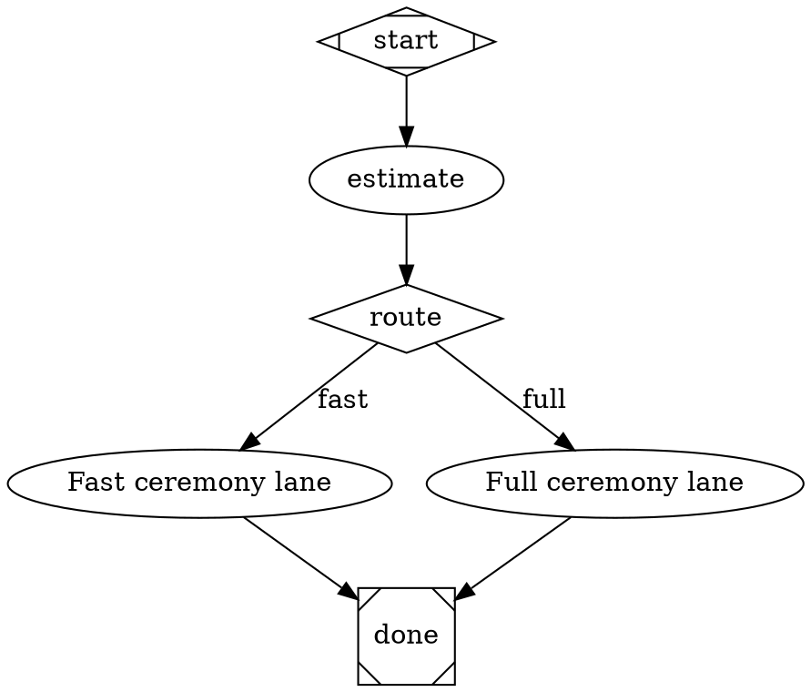

# Complexity Floor Convention

Hatch complexity routing is deterministic and offline. Use `hatch complexity estimate` to classify work as `low|medium|high` from issue metadata, then wire the estimator output into graph context for edge routing.

See also:
- [Hatch Validation Contract](./validation.md)
- [Complexity Estimator Contract](./complexity-estimator.md)
- [Complexity Floor Estimator Convention](./complexity-floor-estimator.md)

## Estimator command contract

```bash
hatch complexity estimate --input '{"issue_title":"...","changed_files":["src/a.ts"],"qa_command":"pnpm test"}'
```

Output payload includes:

- `complexity_class` (`low|medium|high`)
- `signals` (per-signal deterministic values/scores/reasons)
- `reason` (deterministic summary: `class=...;score=...;top=...`)
- `otel_dimension_key` (currently `hatch.complexity.class`)

## DOT wiring: estimator → output_key/outputs → conditional edges

Use an estimator node that preserves full JSON and promotes keys used by routing conditions.



## Validation/provenance warning

When a condition references complexity routing keys (`complexity_class` or legacy `complexity`) but no upstream estimator produces the key via `output_key` or `outputs`, Hatch warns:

- `warning [complexity_estimator_provenance] ...`

Context-flow lint may also warn:

- `context_flow.undefined_reference`

Run both checks during authoring:

```bash
hatch validate my.dot
node scripts/lint-dot.mjs my.dot
```

## Telemetry expectations

Estimator-driven stages should surface complexity metadata in `stage.finish` data:

- `complexity_class`
- `complexity_signals`
- `complexity_reason`
- `complexity_otel_key`
- OTEL dimension key `hatch.complexity.class=<class>`

This enables dashboards to correlate routed branch decisions with deterministic estimator signals.
