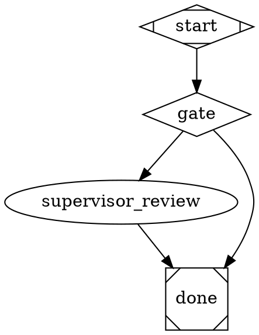
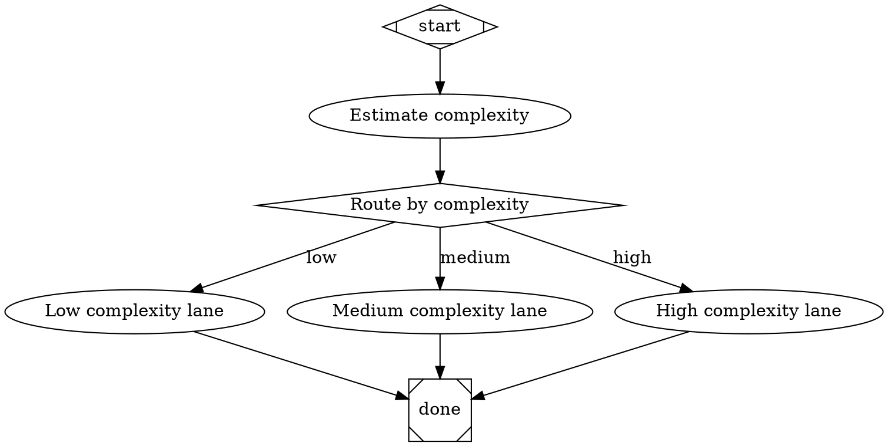

# Hatch Validation Contract

This document defines the stable, machine-consumable validation contract for Hatch graphs.

Related observability reference: [Langfuse KPI Queries](../langfuse-kpis.md).
Related routing convention: [Complexity Floor Convention](./complexity-floor.md).
Estimator contract: [Complexity Estimator Contract](./complexity-estimator.md).
Estimator playbook: [Complexity Floor Estimator Convention](./complexity-floor-estimator.md).

## Langfuse telemetry contract (runtime observability)

Hatch can optionally emit Langfuse telemetry without affecting pipeline correctness.

### Environment configuration

Telemetry is enabled only when both keys are present:

- `LANGFUSE_PUBLIC_KEY`
- `LANGFUSE_SECRET_KEY`

Optional variables:

- `LANGFUSE_BASE_URL` (default: `https://cloud.langfuse.com`)
- `HATCH_LANGFUSE_ENABLED` (`true/false`, default auto-enable when keys are present)
- `HATCH_LANGFUSE_CAPTURE_PROMPTS` (`true/false`, default `false`)
- `HATCH_LANGFUSE_BATCH_SIZE` (default `100`)
- `HATCH_LANGFUSE_MAX_QUEUE_SIZE` (default `5000`)
- `HATCH_LANGFUSE_FLUSH_INTERVAL_MS` (default `250`)

Missing/invalid config is warning-only: Hatch continues and telemetry is disabled.

### Data model: session → trace → span

- **Session**: long-lived agent session (`agent.worktree`, `agent.kw`, `stack.manager_loop`, `codergen`), keyed by `agent_session_id` or synthesized session id.
- **Trace**: pipeline run scope (`run_id` when available).
- **Span**: one EventBus emission or one session lifecycle event.

### Universal metadata schema

All emitted spans include the universal key namespace:

- `hatch.schema_version` (`hatch.telemetry.v1`)
- `hatch.source` (`eventbus|session`)
- `hatch.event_kind`
- `hatch.run_id`
- `hatch.graph_name`
- `hatch.pipeline_file`
- `hatch.node_id`
- `hatch.trust_partition` (`trusted|untrusted`)

Per-event data is flattened under `hatch.event_data.*`.

### Factory context mapping

Per-run factory context is merged from run context keys:

- allowlisted keys (`issue_number`, `milestone_title`, `branch`, `worktree_dir`, `agent_session_id`, etc.)
- optional JSON object keys (`factory_context`, `telemetry_factory_context`, `factory_ctx`)
- prefixed keys (`factory_*`)

Mapped fields are emitted under `factory.<key>` metadata.

### Non-blocking guarantees

- telemetry enqueue is async and off the critical path
- queue overflow uses deterministic drop-on-backpressure (drop newest)
- SDK/transport errors are warnings only
- pipeline execution never fails due to telemetry transport

## Running validation

```bash
hatch validate [--identity-mode <legacy|strict>] <file.dot>
```

- `--identity-mode` controls identity/governance validation behavior.
- Allowed values: `legacy`, `strict`.
- Default (when omitted): `legacy`.
- Unknown `--identity-mode` values are rejected with non-zero exit.

## Recovery ownership contract

Recovery invariants enforce an explicit contract for supervisor-owned remediation paths.
Validation no longer accepts node ids/labels/classes as ownership proof.

### Required markers

- `recovery_owner="supervisor"`
  - marks a node as a supervisor-owned recovery handler.
- `recovery_sink_type="wait|terminal"`
  - marks an approved sink endpoint for recovery paths.
  - `wait` = explicit wait sink, `terminal` = explicit terminal sink.

### Failure diagnostic code

If a failure edge targets a node that is neither supervisor-owned (`recovery_owner="supervisor"`) nor an explicitly approved sink (`recovery_sink_type="wait|terminal"`), validation emits:

- rule: `graph_recovery.unowned_failure_path`
- code: `recovery.owner.missing`

CLI shape:

```text
[graph_recovery.unowned_failure_path:recovery.owner.missing] node "supervisor_review": ... missing recovery_owner="supervisor" ...
```

### DOT example



## Graph-level identity mode

Graphs may set a graph attribute:

```dot
identity_mode = "legacy" // or "strict"
```

Selection order in validation:

1. CLI/API override (`identityMode`) if provided.
2. Graph `identity_mode` when valid.
3. Fallback default: `legacy`.

Invalid graph values are validation errors and emit stable code `identity.mode.invalid`.

## Identity/governance scope

Identity contract checks apply only to trust-participant handlers:

- `tool`
- `stack.manager_loop`
- `agent.worktree`
- `agent.kw`

## Identity mode semantics

### `legacy` (default)

For trust participants:

- `governance` is required.
- `tool_id` and `action_id` are optional.
- If `tool_id` / `action_id` are present, values must be valid.

### `strict`

For trust participants:

- `governance` is required.
- `tool_id` is required and must be valid.
- `action_id` is required and must be valid.

## Typed action transport ratchet

Graphs can opt into fail-closed typed-action transport enforcement before the
repo-wide migration is complete.

Graph-level switch:

- `typed_action_transport_mode = "enforced"`

Meaning:

- opted-in graphs may not use repo-internal CLI transport for deterministic
  internal work
- the `typed_action_graph_transport` gate fails only for opted-in graphs
- non-opted-in graphs remain inventory-only until their migration phase

Example:

```dot
digraph release_report_flow {
  typed_action_transport_mode = "enforced"
}
```

## Stable identity rule codes

Validation diagnostics for this domain include stable `code` values:

- `identity.mode.invalid`
- `identity.tool_id.invalid`
- `identity.tool_id.required`
- `identity.action_id.invalid`
- `identity.action_id.required`
- `identity.governance.required`
- `identity.governance.invalid`
- `identity.governance_decision.invalid`

CLI formatted diagnostics include `[rule:code]` for machine assertions.

Example:

```text
[tool_ids:identity.tool_id.required] node "runner": missing tool_id ...
```

## Complexity estimator convention (`hatch complexity estimate` → `complexity_class` edge conditions)

Canonical convention for deterministic low/medium/high routing:

1. **Estimator emits JSON** from `hatch complexity estimate` with:
   - `complexity_class` (`low|medium|high`)
   - `signals` (deterministic per-signal map including `<signal>_reason`, `<signal>_score`, `<signal>_unknown`)
   - `reason` (deterministic top-signal summary)
   - `score` (deterministic aggregate score)
   - `otel_dimension_key` (currently `hatch.complexity.class`)
2. **Estimator node stores + promotes output** with `output_key` (full JSON) and `outputs="complexity_class,signals,reason"`.
3. **Routing edges consume `complexity_class`** via `condition="complexity_class=low|medium|high"`.

### Reference DOT snippet



### Deterministic heuristic signals (current implementation)

`hatch complexity estimate` computes these signals and sums their scores:

- **`diff_size`**: `small` (≤40 changed lines, score `0`), `medium` (≤200, score `1`), `large` (>200, score `2`), `unknown` (missing line estimate, score `2`).
- **`file_count`**: `small` (≤2 files, score `0`), `medium` (≤8, score `1`), `large` (>8, score `2`), `unknown` (missing count, score `2`).
- **`sensitive_paths`** (file sensitivity): `true` (security/auth/infra/deploy/lockfile-style paths hit, score `2`), `false` (score `0`), `unknown` (missing changed files, score `1`).
- **`side_effect_keywords`** (external-effects heuristic): `true` when issue text includes deploy/migration/database/production/external-api/payments/infrastructure signals (score `2`), `false` (`0`), `unknown` (`1`).
- **`dependency_pressure`** (dependency + relationship count): `none` (`0`), `moderate` (`1`), `high` (`2`), `unknown` (`1`) from `dependency_count + blocked_by_count + blocks_count`.
- **`qa_signal`** (test-coverage proxy): explicit test command present (score `-1`), QA command present without explicit test keyword (score `0`), missing QA command (score `1`).

Class mapping is deterministic: total score `<=1 => low`, `<=5 => medium`, `>5 => high`.
If **any** signal is unknown/missing, classification is elevated to **`high`** (ambiguity defaults high).

`reason` should remain a deterministic summary of dominant signals (`class=...;score=...;top=...`) so reviewers can see why a lane was selected.

### Validator/lint guidance and expected warnings

Complexity routing wiring is validated by both graph validation and context-flow linting:

- `hatch validate <file.dot>` emits warning rule `complexity_estimator_provenance` when an edge condition references `complexity_class` (or legacy alias `complexity`) but no upstream estimator node emits that key via `output_key` or `outputs`.
- `node scripts/lint-dot.mjs <file.dot>` may also emit `context_flow.undefined_reference` when `complexity_class` is referenced before any producer exists in context flow.

Representative warning shapes:

```text
warning [complexity_estimator_provenance] edge route -> high_path uses condition "complexity_class=high" ... An estimator node must precede this complexity-based condition and emit complexity_class (via output_key or outputs) so routing has provenance.
```

```text
{"severity":"warning","rule_id":"context_flow.undefined_reference","message":"edge \"route->high_path\" ... references undefined context key \"complexity_class\" via edge.condition"}
```

Related helper surfaces to cross-check authoring contracts:

- `hatch help attributes` (`output_key`, `output_format`, `outputs`, edge `condition`)
- `hatch help edges` (condition syntax and deterministic edge selection)
- `hatch help context` (context propagation and variable availability)

### Telemetry/OTEL expectations for complexity route verification

When complexity routing is active, operators should correlate estimator output and route selection:

- **Estimator `stage.finish`** should include `complexity_class`, `complexity_signals`, `complexity_reason`, and `complexity_otel_key` in event data.
- **OTEL dimension** keyed by `otel_dimension_key` (currently `hatch.complexity.class`) should carry the same class value.
- **Signal visibility** should include the serialized `complexity_signals` payload (and derived per-signal fields) so dashboards can inspect why the class was chosen.
- **`edge.selected`** remains the source of truth for which branch actually executed.

In JSONL traces (`hatch run --trace ...`), route verification is typically:

1. `stage.finish` for estimator node with complexity payload,
2. `edge.selected` from router to `low_path`/`medium_path`/`high_path`,
3. downstream `stage.start` for the selected branch.

For OTEL exporters layered over Hatch events (F-4 telemetry extension), preserve the same semantic dimensions so dashboards can group by estimator node, selected branch, and complexity signals.

### Ownership and update cadence

- **Owner:** `hatch-runtime` (runtime contract), documented in `docs/` with `docs-stewards` stewardship.
- **Update trigger:** Any change to estimator payload schema, `outputs` extraction behavior, context-flow warning semantics, or telemetry event payload must update this section in the same PR.
- **Minimum cadence:** verify this section during each release that changes routing heuristics or telemetry fields.
