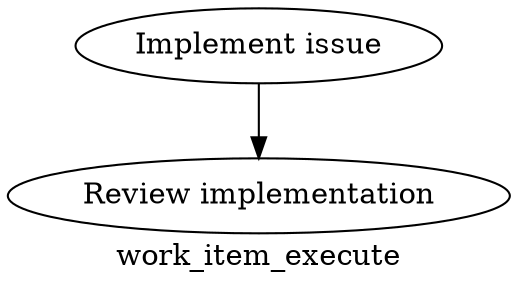

# Factory Design Skill

Design and evolve Hatch factories as production systems, not prompt collections.

> **Required starting point for create/evolve/repair work:** begin with [`docs/skills/factory-create-evolve/SKILL.md`](../factory-create-evolve/SKILL.md) and follow its execution flow (`hatch factory init`, validation, repair guidance) before using this document.

This skill is **repo-agnostic** but uses concrete patterns from this repository so the output is directly executable.

## ⚡ Start here for factory creation, evolution, or repair

For factory **creation/evolution/repair execution**, start with:
- [`docs/skills/factory-create-evolve/SKILL.md`](../factory-create-evolve/SKILL.md)

This `factory-design` file is the **deep reference layer** for:
- invariants,
- graph/handler contracts,
- role contract structure,
- telemetry/versioning requirements,
- reusable templates.

> **Start with [`factory-create-evolve`](../factory-create-evolve/SKILL.md). It is the execution playbook for running `hatch factory init`, validation checks, and repair commands end-to-end. This `factory-design` skill is the deep reference layer for graph contracts, handler roles, template bundles, and telemetry/versioning requirements.**
>
> **Handoff loop:** 1) Start in the playbook for commands + validation flow. 2) Jump into this reference for contract/template details. 3) Return to the playbook to document outputs and validation evidence.

## Trigger conditions

Routing hierarchy (required):
- If the request is "create/evolve/repair a factory," run `factory-create-evolve` first and use this file only as supporting reference.

Use this skill when the user asks to:
- define or audit factory invariants/contracts,
- redesign supervisor/graph topology details,
- define role contracts and retry/judge semantics,
- standardize factory telemetry/versioning/state conventions,
- extend template bundles and deep reference material.

If the request is "factory-like" but vague, trigger discovery and decide whether to start in the playbook or this reference.

| Request type | Open first | Open second |
|---|---|---|
| Bootstrap/evolve/repair execution (`hatch factory init`, validation, repair commands) | [`factory-create-evolve`](../factory-create-evolve/SKILL.md) | `factory-design` for deep contracts/templates when needed |
| Invariants/contracts/template architecture deep dive | `factory-create-evolve` for workflow context | `factory-design` as primary reference |

### Reference vs. Playbook

This document answers **"what are the rules?"** (contracts, invariants, templates, and telemetry requirements).
The playbook answers **"how do I execute?"** (scaffolding, validation commands, repair loop, and output packaging).

For execution flow decisions, jump to [`factory-create-evolve`](../factory-create-evolve/SKILL.md) before proceeding.

## Mandatory meta-workflow: use skill-creator loop

For every major skill change, follow the workflow in:
`~/.claude/skills/skill-creator/SKILL.md`

Required sequence:
1. Draft/update this skill.
2. Create test prompts in `docs/skills/factory-design/evals/evals.json`.
3. Run with-skill and baseline comparisons.
4. Generate reviewer output with `eval-viewer/generate_review.py`.
5. Review feedback + quantitative metrics.
6. Iterate and re-run.

Do not stop at first draft. Run the full draft → test → review → iterate loop.

## Factory mental model (required terminology)

> Before using the terminology table, open [`docs/skills/factory-create-evolve/SKILL.md`](../factory-create-evolve/SKILL.md) first for the canonical command flow, validation evidence format, and deterministic repair guidance.

| Term | Definition |
|---|---|
| **Factory** | End-to-end autonomous production system that continuously turns backlog inputs into shipped outcomes. |
| **Graph** | DOT pipeline entrypoint defining control flow, node handlers, and contracts. |
| **Subgraph / workflow** | Reusable DOT graph invoked from a parent graph (`type="pipeline"`), used to modularize stages. |
| **Role** | A job contract for an LLM worker (inputs, outputs, success criteria, retries). |
| **Deterministic node** | A tool/ops node with reproducible behavior and machine-readable outputs. |
| **Outer loop** | Top supervisor tick that performs health, routing, dispatch, recovery, and governance each cycle. |
| **Production line** | Main execution path for a work item from selection to merge/closure. |
| **State** | Durable truth in external systems (GitHub/issues/milestones/artifacts), not ephemeral process memory. |
| **Infra repo vs work repo** | `factory_repo` hosts factory machinery; `target_repo` hosts product work. Keep ownership and issue routing distinct. |

**Role ≠ skill (non-negotiable):**
- A **role** is a contract in the factory system.
- A **skill** is reusable guidance a role may load.
- One role can use multiple skills; do not collapse role design into one prompt blob.

## Topology and config discovery checklist (collect before scaffolding)

Before running this checklist, execute the `factory-create-evolve` flow first so discovery stays anchored to the supported creation/evolution path rather than becoming a standalone scaffolding shortcut.

Pick one topology first, then capture repo identities and ownership explicitly:

| Topology | Required repo mapping | Guardrail |
|---|---|---|
| **In-repo factory** | `factory_repo == target_repo`; `infra_issue_repo` may still be separate | Do not assume infra bugs belong in product labels/issues by default. |
| **Separate infra repo** | `factory_repo != target_repo`; `infra_issue_repo` is explicit (often `factory_repo`) | Never conflate infra defects with target-repo product work. |

Discovery checklist (required):
- `factory_repo`
- `target_repo`
- `infra_issue_repo`
- local working paths for each repo/worktree root
- worktree strategy (shared branch vs per-issue worktrees, naming, cleanup)
- infra-bug reporting preference (auto-file vs manual, labels/milestones)
- runtime ownership (who starts/stops dispatch + supervisor daemons)
- capacity settings (`max_concurrent_waves`, `max_goal_runs_per_tick`, etc.)

`templates/config-schema.json` must capture, at minimum:
- repo identities (`factory_repo`, `target_repo`, `infra_issue_repo`),
- entrypoint graph path,
- per-node model overrides/defaults,
- issue routing rules for infra vs product work.

## Required scaffold outputs

Generate all outputs below (no toy/minimal placeholder set unless explicitly requested).
Every file must be customized for the target factory; none are "leave as-is" placeholders.

| Required file | Role in the system | Customization requirement |
|---|---|---|
| `templates/factory-spec.md` | Canonical design spec (topology, ownership, invariants) | Fill with concrete repos, workflows, and failure-handling policy. |
| `templates/subgraph-goal-queue.dot` | Reusable goal intake/queueing workflow | Encode real selection logic, routing labels, and outputs. |
| `templates/subgraph-wave-dispatch.dot` | Reusable dispatch/capacity workflow | Encode concrete slot checks, claim policy, and rerun behavior. |
| `templates/subgraph-production-line.dot` | Reusable execution/review/judge/merge workflow | Bind real role contracts, retry bounds, and evidence outputs. |
| `templates/config-schema.json` | Typed runtime config contract | Define repo identity, entrypoint graph, model policy, and issue routing keys. |
| `references/metrics-versioning.md` | Required telemetry/versioning contract | Adopt required metric keys and version fields in all role/node outputs. |
| `templates/runbook.md` | Operational start/stop/inspect/recover guide | Document real daemon/ops commands, logs, PIDs, and ownership. |
| `templates/state-conventions.md` | Durable state + transition ownership map | Map every state transition to one owner and one source of truth. |

## Reusable template bundle (customize, do not copy verbatim)

Use the concrete templates in `docs/skills/factory-design/templates/` as your starting point,
then extend/rename to satisfy the required file set above.

Accelerator templates in this repo:
- [`factory-spec.md`](templates/factory-spec.md) (factory architecture/spec template)
- [`top-level-graph.dot`](templates/top-level-graph.dot) (outer-loop skeleton: bug gate, block detection, capacity, dispatch, supervisor review)
- [`subgraph-goal-queue.dot`](templates/subgraph-goal-queue.dot) (goal intake/queue orchestration skeleton)
- [`subgraph-wave-dispatch.dot`](templates/subgraph-wave-dispatch.dot) (wave selection/marker management skeleton)
- [`subgraph-production-line.dot`](templates/subgraph-production-line.dot) (nested issue execution/review/judge/merge skeleton)
- [`role-definitions.md`](templates/role-definitions.md) (Supervisor, Issue/Triage Writer, Coder, Reviewer, Merger, Judge contracts)
- [`evaluation-hooks.md`](templates/evaluation-hooks.md) (copy-pastable metrics + judge context hooks)

These templates are intentionally derived from production implementations in:
- `factories/mothership/graphs/*`
- `hatch-ops` command families (`@hatch/factory-ops`)

When iterating templates or prompts, follow the full skill-creator loop in:
`~/.claude/skills/skill-creator/SKILL.md`

### Real repo patterns to reference (examples, not hardcoded requirements)

Use these as known-good topology examples:
- `factories/mothership/graphs/factory_supervisor_tick.dot`
- `packages/capability-goal-decomposition/graphs/goal_run.dot`
- `factories/mothership/graphs/wave_execute.dot`
- `packages/capability-goal-decomposition/graphs/goal_queue.dot`
- `factories/mothership/graphs/wave_dispatch.dot`

## Outer-loop hard requirements

Every factory outer loop must implement:

1. **Health detection** (factory healthy/degraded/broken)
2. **Blocked/broken routing** (triage path before new work)
3. **Infra bug routing** (`infra_issue_repo` destination is explicit)
4. **Pause/resume controls** (operator gate and deterministic resume)
5. **Capacity gate** (respect configured concurrency)
6. **Dispatch selection** (deterministic selection policy)
7. **Recovery sweep** (stale run/worktree reconciliation)
8. **Outcome checks** (shipped deltas, not stage churn)

Prefer nested subgraphs over monolithic graphs.

## Node-level model/config requirements

- Allow per-node model/provider overrides in DOT/model stylesheet.
- Emit `model_id`, `role_version`, and `prompt_version` for every LLM node/role output.
- Track model selection decisions at node granularity (not only per-run).
- Emit judge scope identity (`judge_context_identity`: repo/issue/wave/scenario/run/attempt) so downstream attribution is unambiguous and `JUDGE_CONTEXT_INVALID` is prevented.
- Keep deterministic routing/data transforms in tool nodes, not LLM free-form text.

## Role contracts (required roles)

Define each role with responsibility, input contract, output contract, retry/review behavior, and measurable success criteria.

### 1) Supervisor
- **Responsibility:** Own outer-loop control, health, recovery, and dispatch gating.
- **Input contract:** state snapshot, queue state, active runs, capacity config, incident/action items.
- **Output contract:** next actions, dispatch decision, routed bug actions, status artifact.
- **Retry/review behavior:** bounded retries on transient infra failures; escalate deterministic incidents.
- **Success criteria:** tick completes, no unowned stuck states, routed incidents have explicit owner.

### 2) Issue Writer / Triage
- **Responsibility:** Convert goals into executable work items with dependency clarity.
- **Input contract:** goal text, constraints, prior outcomes, milestone context.
- **Output contract:** issue set with acceptance criteria, dependencies, labels/milestones, priority.
- **Retry/review behavior:** revise when spec ambiguity detected; prevent duplicate issue emission.
- **Success criteria:** downstream coder/reviewer can execute without clarifying questions.

### 3) Coder
- **Responsibility:** Implement scoped issue changes in isolated workspace/worktree.
- **Input contract:** issue spec, repo context, branch/worktree policy, test expectations.
- **Output contract:** commit(s), change summary, test evidence, artifact references.
- **Retry/review behavior:** bounded revise loop from reviewer/judge feedback.
- **Success criteria:** acceptance criteria met with deterministic verification evidence.

### 4) Reviewer
- **Responsibility:** Validate correctness, scope control, and contract compliance.
- **Input contract:** issue spec, changed files/commit range, evidence artifacts.
- **Output contract:** approve/revise decision with machine-readable reasons.
- **Retry/review behavior:** must produce actionable revision guidance when rejecting.
- **Success criteria:** high precision on real defects, low false rejection rate.

### 5) Merger
- **Responsibility:** Integrate approved work safely and finalize issue/marker transitions.
- **Input contract:** approved branch, merge policy, conflict context, required evidence.
- **Output contract:** merge result, closure comment, post-merge state updates.
- **Retry/review behavior:** deterministic conflict resolution path; escalate irreconcilable policy blocks.
- **Success criteria:** merged outcomes with consistent state closure and zero orphan markers.

### 6) Judge
- **Responsibility:** Scenario-based quality gate independent of implementation role.
- **Input contract:** scenario definitions, acceptance criteria, evidence payload.
- **Output contract:** pass/fail + diagnostics + required remediation context.
- **Retry/review behavior:** bounded loop with explicit failure categories.
- **Success criteria:** measurable pass/fail signal correlates with production quality outcomes.

## Instrumentation points and deterministic ops

Reference deterministic `hatch-ops` CLI operations for design patterns.

Examples:
- `supervisor state-snapshot` (historically represented as `supervisor run --op state-snapshot`)
- `wave dispatch-select` (historically represented as `wave run --op dispatch-select`)

Use these as examples of where to emit telemetry and invariants:
- pre-dispatch snapshot,
- dispatch decision payload,
- review/judge outcomes,
- merge closure signals.

## Metrics and versioning requirements

Every factory design must capture, persist, and report:
- retries per work item,
- review cycles per item,
- failure rate by role,
- judge pass/fail rate,
- per-node model/provider configuration,
- role version and prompt version,
- throughput outcomes (merged/closed work, not just run activity).

## Guardrails (non-negotiable)

- **No phantom monitoring / autonomy theater:** never claim continuous monitoring unless a real daemon/workflow is installed and observable.
- **No haunted shell scripts:** no hidden temp runtime loops (`/tmp` hacks, invisible while loops, orphan background scripts).
- **No hidden temp-runtime daemons:** long-lived services must have explicit install/start/stop/log/PID ownership.
- **Document runtime ownership:** every long-lived process must be anchored to runbook procedures with concrete ops/CLI commands and log locations.
- **No vague promises:** avoid "monitor later" / "will keep watching" statements without an active mechanism.
- **No infra/work repo conflation:** route infra bugs to `infra_issue_repo`; route product work to `target_repo`.
- **No unsolicited minimal outputs:** do not downgrade to toy scaffolds unless user explicitly requests minimal output.

## Judge scenario requirement (prevents JUDGE_CONTEXT_INVALID)

For every factory, define judge scenario context before wiring judge nodes.

Missing scenarios will trigger:
`JUDGE_CONTEXT_INVALID: judge_context_scenarios_missing`

Required artifacts:
- scenario definition files,
- scenario-to-judge mapping in graph/config,
- evidence payload contract for each scenario,
- failure taxonomy for deterministic retry/route behavior.

## Output-to-validation mapping

For each promised output, provide validation hooks:

| Output | Required references | Validation hook |
|---|---|---|
| Factory spec | topology, role matrix, state model | `hatch validate <graph.dot>` on all listed graphs |
| Top-level graph | supervisor tick entrypoint | `hatch validate`, then `hatch run <entrypoint.dot>` smoke path |
| Subgraphs | goal/dispatch/execute/review composition | `hatch validate` per subgraph + parent integration run |
| Role definitions | role contracts + prompts/skills | contract review + run evidence fields include role/prompt version |
| Config schema | typed defaults + capacity gates | config load command and dispatch/supervisor dry-run |
| State conventions | durable entities + transitions | runbook includes inspect commands for each state entity |
| Evaluation hooks | judge scenarios + review loop metrics | judge node execution emits pass/fail + retry/review counters |
| Runbook | operational procedures | start/stop/inspect/recover commands are runnable as written |

### Required command references in runbook

Include these concrete command families:
- `hatch validate <graph.dot>`
- `hatch run <graph.dot>`
- `hatch dispatch [--once|--interval ...]` via `apps/hatch/src/cli.ts`
- dispatch implementation reference: `runDispatchLoop` in `apps/hatch/src/dispatch/loop.ts`

## Testing expectations for this skill doc

After editing this skill, run:

```bash
pnpm docs:check
pnpm docs:state:check
```

Manually verify this file still contains:
- mental model terms,
- role ≠ skill warning,
- discovery checklist with infra/work separation,
- role contracts (Supervisor, Issue Writer/Triage, Coder, Reviewer, Merger, Judge),
- guardrails and judge scenario requirements,
- skill-creator workflow reference (`~/.claude/skills/skill-creator/SKILL.md`),
- eval harness reference (`docs/skills/factory-design/evals/evals.json`).

Read `references/factory-layout.md` for the full layout reference.

#### Per-Node Model Selection (required)

Model selection must be explicit and testable. Define global defaults and node-level overrides in config,
then bind those values to concrete graph node IDs.

Example config contract (JSON/YAML equivalent):

```json
{
  "model_policy": {
    "defaults": {
      "llm_model": "openai/gpt-5.3-codex",
      "model_stylesheet": "* { llm_model: openai/gpt-5.3-codex; llm_provider: openrouter; }"
    },
    "node_overrides": {
      "coder": {
        "llm_model": "openai/gpt-5.3-codex",
        "model_stylesheet": "coder { reasoning_effort: medium; }"
      },
      "reviewer": {
        "llm_model": "openai/o3",
        "model_stylesheet": "reviewer { reasoning_effort: high; }"
      }
    }
  }
}
```

Example DOT/config alignment (two roles, different models):



Generated typed config should expose this schema explicitly (for example `factory_config/schema.ts`) so
model selection is unit-testable and diffable in review:

```ts
export interface FactoryConfig {
  model_policy: {
    defaults: { llm_model: string; model_stylesheet: string };
    node_overrides: Record<string, { llm_model: string; model_stylesheet?: string }>;
  };
  metrics: {
    required_keys: string[];
  };
}
```

### Phase 3: Design the outer loop

The supervisor tick is the heartbeat. It runs periodically and must execute this ordered
resilience loop before any production-line work starts:

| Order | Check | Required inputs | Required outputs |
|---|---|---|---|
| 1 | **Health check** | Daemon heartbeat, active run table, recent fail/complete counts | `health_state` (`healthy`/`degraded`/`broken`), `health_reason` |
| 2 | **Blocked/broken detection** | Backlog age, blocked issue relationships, terminal/stalled run signatures | `dispatch_state` (`clear`/`blocked`/`broken`), `block_reason` |
| 3 | **Infra bug routing decision** | `dispatch_state`, failure classification, `infra_issue_repo`, `target_repo` | `route_repo`, created/reused bug issue id, rerun decision |
| 4 | **Pause / wait / resume guardrail** | Manual pause flags, cooldown timers, active remediation work | `loop_action` (`pause`/`wait`/`resume`), `resume_at`, `guardrail_reason` |
| 5 | **Capacity / slot check** | `max_concurrent_waves`, active wave count, ready-wave queue length | `available_slots`, `dispatch_budget` |
| 6 | **Production-line dispatch** | Ready waves, `dispatch_budget`, judge context identity payload | Claimed wave ids, node labels/conditions for next hop, rerun trigger |

Concrete guardrails for this phase:
- Never emit "monitor later" or "will watch" claims unless the graph or runbook also defines an
  actual daemon/service command, PID ownership, log path, and stop command.
- Every gate must emit machine-readable decision labels so retries/reruns are deterministic.
- Judge context identity must flow through this loop (for example `judge_context_identity` with
  `repo`, `issue`, `wave`, `scenario`, `run_id`) so judge nodes never execute with ambiguous scope.

The outer loop graph should be the most robust graph in the factory. Every node should
handle failure gracefully. Use diamond gates liberally to route around problems rather
than crashing the whole tick.

Read `references/graph-patterns.md` for the gate, retry loop, and fan-out patterns.

### Phase 4: Define role contracts

Each role needs a contract file. The contract defines:

Use `references/metrics-versioning.md` for the required telemetry keys and version labels that every role output contract must expose.

```markdown
## Role: <name>

### Responsibility
What this role does in one sentence.

### Input contract
| Key | Type | Source | Description |
|-----|------|--------|-------------|
| ... | ... | ... | ... |

### Output contract
| Key | Type | Description |
|-----|------|-------------|
| ... | ... | ... |

### Success criteria
- Measurable condition 1
- Measurable condition 2

### Retry behavior
- Max attempts: N
- On failure: <what happens>
- Cooldown: <if applicable>

### Model selection
- Primary: <model-id>
- Reasoning effort: low | medium | high
```

When assigning per-role or per-node model overrides, follow `references/metrics-versioning.md` so `model_id`, `role_version`, and `prompt_version` are emitted consistently.

For the **Judge** role, make context identity explicit in the contract input keys. Require a
`judge_context_identity` object (for example `repo`, `issue`, `wave`, `scenario`, `run_id`, `attempt`)
so review/judge outputs can be tied to a single scope and cannot trigger `JUDGE_CONTEXT_INVALID`.

Read `references/role-contracts.md` for the default role set with complete contracts.

### Phase 5: Design state conventions

State must live in a durable external system, never in local files. For GitHub-backed factories:

| Entity | Representation | Status tracking |
|--------|----------------|-----------------|
| **Goal** | GitHub issue with `goal` label | Open = active, Closed = done |
| **Work item** | GitHub issue with domain label | Open = pending, Closed = done |
| **Batch/wave** | GitHub milestone | Open issues = remaining work |
| **Wave marker** | GitHub issue titled "Wave Ready: ..." | `ready` label = dispatchable |
| **Bug** | GitHub issue with `bug` label | Open = needs fix |

**Key principle:** If the factory crashes and restarts, the next tick should be able to
read durable state and pick up where things left off. No critical state in process memory.

Run state (`.hatch/runs/`) is ephemeral and local. It's useful for debugging but not
authoritative. The authoritative state is always the external system.

### Phase 6: Wire the graphs

Write the DOT graph files. Read `references/dot-format.md` for the complete format
specification, and `references/handler-types.md` for all available handler types.

**Key patterns to follow:**

**Every graph needs start and done nodes:**
```dot
digraph my_pipeline {
    label = "my_pipeline"
    workdir = "."
    model_stylesheet = "\
        * { llm_model: openai/gpt-5.3-codex; llm_provider: openrouter; }\
    "
    start [shape=Mdiamond]
    done [shape=Msquare]

    // ... nodes and edges ...

    start -> first_node -> ... -> done
}
```

**Use diamond gates for conditional routing:**
```dot
gate [shape=diamond label="Ready?"]
gate -> proceed [condition="ready=true"]
gate -> skip [condition="ready!=true"]
```

**Use tool nodes for deterministic ops:**
```dot
fetch_state [type="tool" governance="reversible"
             label="Fetch current state"
             output_key="state"
             output_format="json"
             outputs="item_count,has_work"
             prompt="hatch-ops status check"
             trust_domain="factory.local" trust_role="factory.local.tool"]
```

**Use pipeline nodes for subgraph composition:**
```dot
execute_item [type="pipeline"
              label="Execute work item"
              pipeline="graphs/work_item_execute.dot"
              inherit_context="true"
              export_keys="result"
              trust_domain="factory.local" trust_role="factory.local.pipeline"]
```

**Use fan_out.dynamic for parallel batch processing:**
```dot
fan_out_items [type="fan_out.dynamic"
               label="Execute items in parallel"
               source_key="items_array"
               item_key="item"
               template="graphs/work_item_execute.dot"
               export_keys="item_result"
               trust_domain="factory.local" trust_role="factory.local.fan_out"]

fan_in_items [type="fan_in.dynamic"
              label="Collect item results"
              output_key="item_results"
              trust_domain="factory.local" trust_role="factory.local.fan_in"]

// Must be adjacent
fan_out_items -> fan_in_items
```

### Phase 7: Add evaluation hooks

Every factory needs measurable quality gates.
Use `references/metrics-versioning.md` for the canonical telemetry keys and versioning conventions used by judge/review instrumentation in this phase.

**Judge nodes** — scenario-based LLM evaluation before terminal decisions:
```dot
judge [label="Quality judge"
       class="critic"
       judge="true"
       scenarios="my-factory/quality-check"
       output_key="judge_result"
       output_format="json"
       outputs="judge_pass,judge_notes,judge_context_identity"
       prompt="Evaluate only the scoped work. Return JSON with judge_pass, judge_notes, and judge_context_identity."]
```

Judge context identity must be carried into and out of judge nodes (for example:
`repo`, `issue`, `wave`, `scenario`, `run_id`, `attempt`) to prevent invalid-scope judgments.

**Review loops** — bounded retry with reviewer feedback:
```
build → review → review_gate
review_gate → done [condition="verdict=approve"]
review_gate → build [condition="verdict=revise && retry_count<3"]
review_gate → give_up [condition="verdict=revise && retry_count>=3"]
```

### Phase 8: Metrics & Versioning (required)

Document and instrument metrics/versioning as first-class outputs, not optional notes.
Use the canonical contract at [`docs/skills/factory-design/references/metrics-versioning.md`](references/metrics-versioning.md).

At minimum, require these runtime-observable fields in node outputs or telemetry envelopes:
- `retry_count` (retries per node/work item)
- `review_cycle_count` (review loop depth)
- `failure_category` / failure-rate aggregation dimensions
- `judge_result` (`pass`/`fail`/`not_applicable`)
- `model_id` (per-node model usage)
- `role_version`
- `prompt_version`

Implementation guidance:
- Add a typed `metrics` section in config/schema so required keys are testable.
- Propagate model/version fields through all LLM nodes; never infer versions from node IDs.
- Ensure validation hooks (or DOT metadata assertions) fail if required metrics keys are absent.

### Phase 9: Write the runbook

Every factory needs a runbook covering:

1. **How to start** — what command runs the factory? What env vars are needed?
2. **How to stop** — how to gracefully shut down without losing work
3. **How to inspect** — CLI commands to check factory status, current tick, active runs
4. **How to recover** — what to do when a run crashes, a wave stalls, or state drifts
5. **How to extend** — how to add a new role, a new subgraph, or a new production line
6. **How to monitor** — what to watch, what signals mean progress vs. stalling
7. **Outer-loop guardrails table** — the six resilience checks, each input/output, and pause/resume policy

## Guardrails

These rules prevent common factory design antipatterns:

**No fake autonomy.** Never claim the factory "monitors" or "watches" unless an actual
daemon process is explicitly created and installed. An LLM saying "I'll keep an eye on
this" is meaningless — it won't exist after the conversation ends.

**No haunted shell scripts.** Never hide long-lived processes in temp directories.
Factory daemons must have explicit PID files, log directories, kill procedures, and documented ops commands in the runbook.

**No ghost state.** Critical state lives in the durable external system (GitHub, DB).
If you can't query it with a CLI command, it doesn't count as state.

**No scope confusion.** The factory infra repo and the target work repo may be different.
Never confuse which repo a bug, issue, or PR belongs to.

**No minimal scaffolds.** When asked to create a factory, generate the real thing — not
a toy demo with TODO comments. Every generated graph should be valid (`hatch validate`),
every role should have a contract, every config key should have a default.

**No future promises.** Never describe work the agent will do "later" or "in the next
session." If it's not happening now, create an issue for it.

**Deterministic ops over inline prompts.** Logic that can be deterministic (counting,
routing, state queries, JSON manipulation) belongs in tool nodes calling ops commands,
not in LLM prompts. LLMs are for judgment and generation. Math and routing are for code.

## Reference files

These contain detailed specifications. Read them when you need the full details:

| File | When to read |
|------|-------------|
| `references/dot-format.md` | Writing DOT graph files — full syntax, attributes, edge conditions |
| `references/handler-types.md` | Choosing the right handler type for a node |
| `references/role-contracts.md` | Defining role input/output contracts and retry behavior |
| `references/metrics-versioning.md` | Canonical telemetry keys, required/optional metrics schema, and role/prompt/model version tagging |
| `references/graph-patterns.md` | Common patterns: gates, retry loops, fan-out, shared sessions |
| `references/factory-layout.md` | Directory structure and config schema |

## Validation checklist

Before declaring a factory complete, verify:

- [ ] Required scaffold files exist and are customized for the target factory: `templates/factory-spec.md`, `templates/subgraph-goal-queue.dot`, `templates/subgraph-wave-dispatch.dot`, `templates/subgraph-production-line.dot`, `templates/config-schema.json`, `templates/runbook.md`, `templates/state-conventions.md`
- [ ] `hatch validate` passes on every DOT file
- [ ] Lint passes on every DOT file (no errors, warnings are OK)
- [ ] Every non-start/exit node has a `label`
- [ ] Every tool node with mutations has `governance="irreversible"`
- [ ] Every tool node has `output_key` or `outputs`
- [ ] Every role has a written contract (input, output, retry, success criteria)
- [ ] Judge role contract includes explicit `judge_context_identity` input/output keys
- [ ] Config has defaults for all capacity limits
- [ ] `factory_config/schema.ts` (or equivalent typed schema) exposes `model_policy`, `node_overrides`, and `metrics`
- [ ] At least two LLM roles (for example `coder`, `reviewer`) show distinct `llm_model`/`model_stylesheet` selections in config and DOT
- [ ] State conventions are documented (what lives where, what labels mean)
- [ ] Outer loop documents all six resilience checks in order: health, blocked/broken, infra routing, pause/wait/resume, capacity, dispatch
- [ ] Outer-loop nodes define concrete inputs/outputs and deterministic decision labels/rerun triggers
- [ ] Infra bug routing rule is explicit (`infra_issue_repo` vs local repo issue filing)
- [ ] No monitoring claims without an explicit daemon/service command and runbook procedure
- [ ] At least one quality gate exists (judge, reviewer, or assert)
- [ ] Metrics & versioning plan is documented and links to `references/metrics-versioning.md`
- [ ] Validation hooks or node metadata assert required telemetry keys (`retry_count`, `review_cycle_count`, `failure_category`, `judge_result`, `model_id`, `role_version`, `prompt_version`)
- [ ] Runbook covers: start, stop, inspect, recover, extend, outer-loop guardrails
- [ ] No inline scripts in tool prompts without `# hatch:no-inline-script-ok` marker
- [ ] Paths in pipeline/template attributes are repo-root-relative

## Related Docs

### Playbook
- [factory-create-evolve/SKILL.md](../factory-create-evolve/SKILL.md)

### References
- [dot-format.md](references/dot-format.md)
- [factory-layout.md](references/factory-layout.md)
- [graph-patterns.md](references/graph-patterns.md)
- [handler-types.md](references/handler-types.md)
- [metrics-versioning.md](references/metrics-versioning.md)
- [role-contracts.md](references/role-contracts.md)

### Workspace Outputs
- Historical benchmark outputs were intentionally removed from `docs/` to keep the canonical skill docs focused on reusable guidance.
