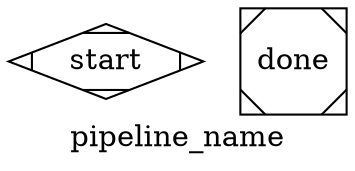

# DOT Graph Format Reference

Hatch pipelines are defined as directed graphs in DOT format. This reference covers the
full syntax for writing valid, lint-clean graph files.

## Graph structure



### Graph-level attributes

| Attribute | Required | Description |
|-----------|----------|-------------|
| `label` | yes | Human-readable graph name |
| `workdir` | yes | Working directory for tool execution (relative to repo root) |
| `model_stylesheet` | no | CSS-like model assignment rules (see below) |

## Model stylesheet

CSS-like syntax for assigning LLM models to nodes by selector:

```dot
model_stylesheet = "\
    * { llm_model: openai/gpt-5.3-codex; llm_provider: openrouter; }\
    .critic { llm_model: openai/gpt-5.1-codex-mini; llm_provider: openrouter; }\
    #judge_node { llm_model: openai/gpt-5.2-codex; llm_provider: openrouter; }\
"
```

| Selector | Specificity | Matches |
|----------|-------------|---------|
| `*` | lowest | All nodes |
| `.classname` | medium | Nodes with `class="classname"` |
| `#nodeid` | highest | Node with that exact ID |

Higher specificity overrides lower. Properties: `llm_model`, `llm_provider`, plus any
node attribute.

## Node attributes

Every non-start/exit node **must** have a `label` attribute.

### Common attributes

| Attribute | Description |
|-----------|-------------|
| `label` | Human-readable description (required) |
| `type` | Handler type (see handler-types.md) |
| `shape` | Visual shape (usually inferred from type) |
| `class` | CSS class for stylesheet matching |
| `timeout` | Max execution time: `"30s"`, `"2m"`, `"25m"`, `"4h"` |
| `reasoning_effort` | LLM thinking depth: `"low"`, `"medium"`, `"high"` |
| `llm_model` | Override model for this node |
| `llm_provider` | Override provider for this node |

### Output attributes

| Attribute | Description |
|-----------|-------------|
| `output_key` | Single context key for node output |
| `output_format` | `"json"` to parse output as JSON |
| `outputs` | Comma-separated keys extracted from JSON output |

### Trust attributes

| Attribute | Description |
|-----------|-------------|
| `trust_domain` | Trust domain identifier (e.g., `"factory.local"`) |
| `trust_role` | Role within domain (e.g., `"factory.local.tool"`) |

If `trust_domain` is set, `trust_role` must also be set.

## Edge syntax

### Basic edges
```dot
start -> node1 -> node2 -> done
```

### Conditional edges
```dot
gate -> path_a [condition="key=value"]
gate -> path_b [condition="key!=value"]
gate -> path_c [condition="count>=5"]
gate -> path_d [condition="status=ready && approved=true"]
```

### Supported operators
| Operator | Description |
|----------|-------------|
| `=` | String equality (trimmed) |
| `!=` | Not equal |
| `>` | Numeric greater-than |
| `<` | Numeric less-than |
| `>=` | Numeric greater-or-equal |
| `<=` | Numeric less-or-equal |
| `&&` | Logical AND (chain conditions) |

### Edge attributes
| Attribute | Description |
|-----------|-------------|
| `condition` | Guard condition for traversal |
| `label` | Visual label on edge |

## Variable substitution

All `prompt` attributes support `${variable}` interpolation from the pipeline context:
```dot
prompt="node ops/cli.mjs run --repo '${gh_repo}' --issue '${issue_number}'"
```

Context is built up as nodes execute — each node's `output_key` / `outputs` add to the
context map. Downstream nodes can reference any previously-set key.

**Built-in context keys** (always available):
- `${__run_id}` — current pipeline run ID
- `${__run_sessions_dir}` — session directory path

## Lint rules

The pre-commit/CI entrypoint is `scripts/lint-dot.mjs`, which runs the canonical linter implementation in `scripts/dot-lint.mjs`.

| Rule | Severity | What it checks |
|------|----------|---------------|
| `node.label.required` | error | Every non-start/exit node has a label |
| `tool.governance.required` | error | Tool nodes with mutations have `governance="irreversible"` |
| `tool.output_metadata.required` | error | Tool nodes have output_key or outputs |
| `prompt.shell_metasyntax` | error | Tool prompt contains shell metasyntax that would execute under `sh -c` |
| `tool.prompt.declarative_policy` | error | Tool prompt must be a single literal command + args with no shell metasyntax |
| `trust.role.required` | error | If trust_domain is set, trust_role must be too |
| `prompt.shell_unsafe_arg` | error | No multi-line user content in shell single-quotes |
| `prompt.inline_script` | error | No inline scripts without exemption marker |
| `context_flow.undefined_reference` | warning | Node references context key not yet produced |
| `context_flow.unused_output_key` | warning | Tool produces key never consumed downstream |

### Declarative tool prompt policy

`type="tool"` prompts are declarative command specs validated by `scripts/dot-lint.mjs`.

Allowed shape:
- one literal command token,
- literal flags/args,
- `${context.<key>}` placeholders only as argument values.

Forbidden shell metasyntax (linted as `prompt.shell_metasyntax`):
- pipes/chaining: `|`, `||`, `&&`, `;`
- redirects/heredocs: `>`, `>>`, `<`, `<<`, `<<<`, `>&`, `&>`
- subshells/command substitution: `$(`...`)`, backticks

Additional declarative policy checks (linted as `tool.prompt.declarative_policy`):
- newline-separated multi-command prompts
- non-literal command tokens or `${context.*}` in command position

Examples:
```dot
// CORRECT: single literal command + args + context placeholders
prompt="node ops/cli.mjs judge run --repo '${context.repo}' --context '${context.judge_context}'"

// WRONG: shell pipe
prompt="node ops/cli.mjs wave report --repo '${context.repo}' | jq -r .status"
```

Practical validation:
```bash
node scripts/dot-lint.mjs factories/mothership/graphs/wave_execute.dot
```

Deterministic violation telemetry:
- `[dot-lint] shell_metasyntax_violation file=... line=... node_id=... node_label=... forbidden_token=... snippet=...`
- `[dot-lint] tool_prompt_policy_violation file=... node_id=... node_label=... forbidden_token=... snippet=...`

### Shell-unsafe argument pattern

This is an error:
```dot
// WRONG: issue_body may contain quotes/newlines that break shell parsing
prompt="gh issue comment ${issue} --body '${issue_body}'"
```

Fix: use base64 encoding or have the ops command fetch the data itself:
```dot
// CORRECT: ops command fetches issue body via API
prompt="node ops/cli.mjs issue run --op comment --issue '${issue_number}'"
```

### Inline script exemption

If a tool node must contain an inline script, add the marker:
```dot
prompt="# hatch:no-inline-script-ok\npython3 -c 'import sys; ...'"
```

Debt is tracked and enforced against a baseline.

## Common patterns

### Diamond gate (conditional routing)
```dot
check [type="tool" governance="reversible"
       label="Check readiness"
       output_key="status"
       prompt="..." trust_domain="f.l" trust_role="f.l.tool"]

gate [shape=diamond label="Ready?"]

check -> gate
gate -> proceed [condition="status=ready"]
gate -> wait [condition="status!=ready"]
```

### Retry loop with bounded retries
```dot
build -> review -> review_gate
review_gate -> done [condition="verdict=approve"]
review_gate -> increment_retry [condition="verdict=revise"]
increment_retry -> retry_gate
retry_gate -> build [condition="retry_count<3"]
retry_gate -> give_up [condition="retry_count>=3"]
```

### Fan-out batch processing
```dot
enumerate [type="tool" ...
           output_key="items"
           prompt="..."]

fan_out [type="fan_out.dynamic"
         source_key="items"
         template="graphs/process.dot"
         ...]

fan_in [type="fan_in.dynamic"
        output_key="results"]

enumerate -> fan_out -> fan_in -> done
```
