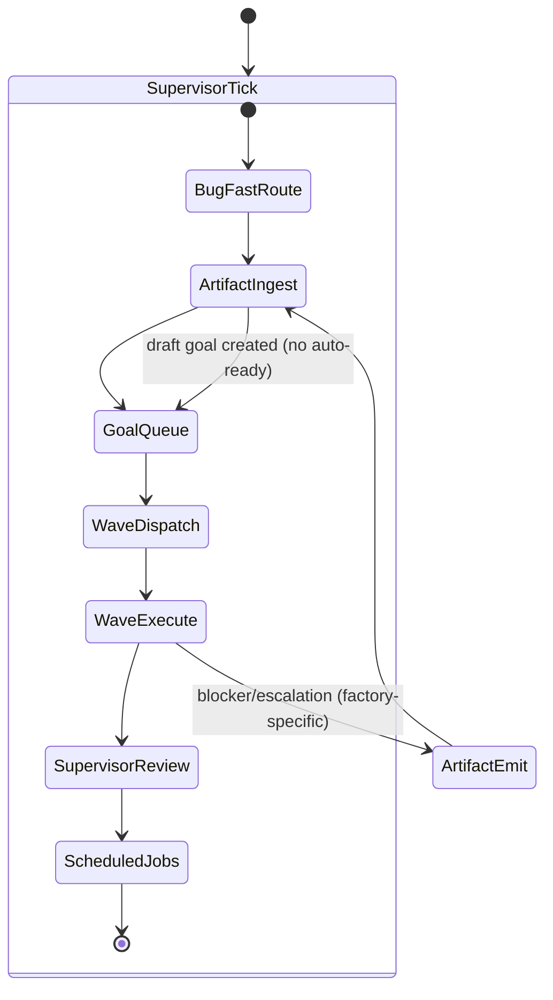
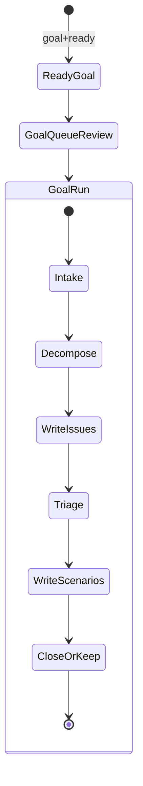
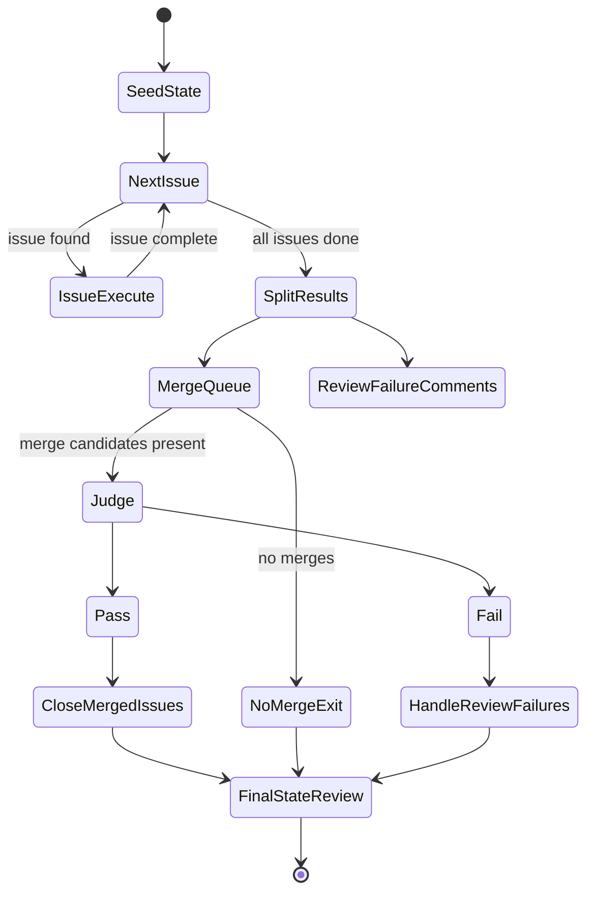
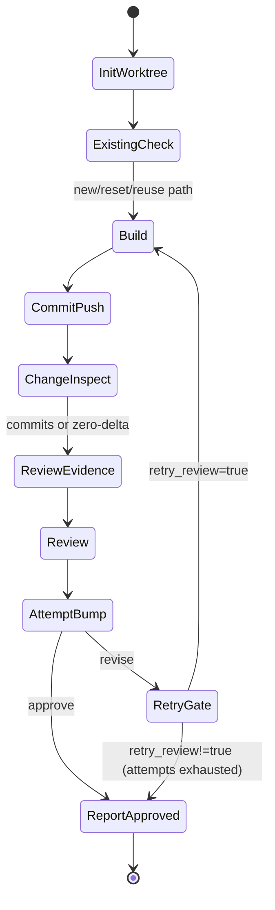
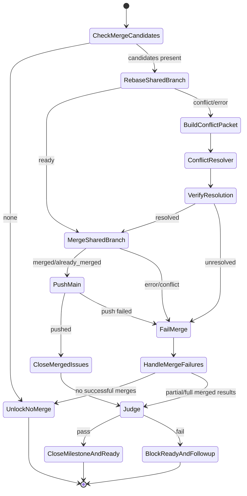
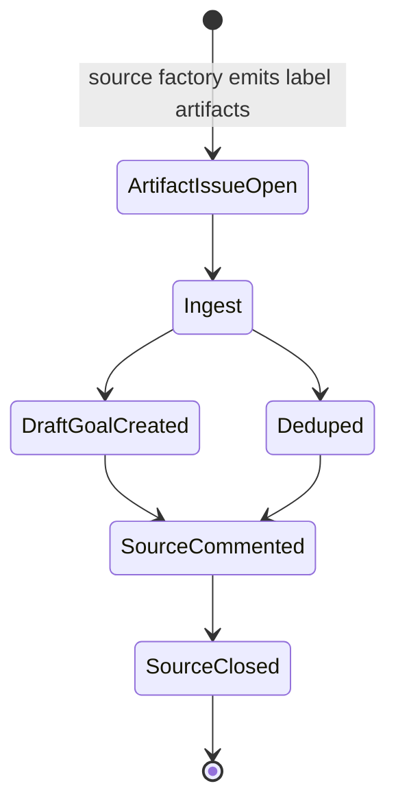
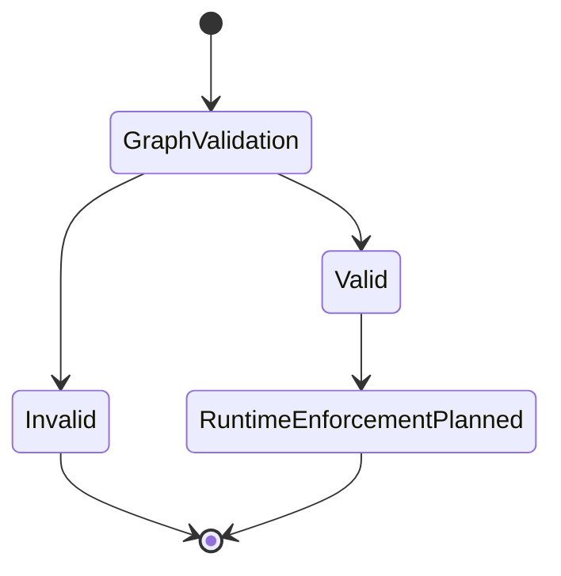
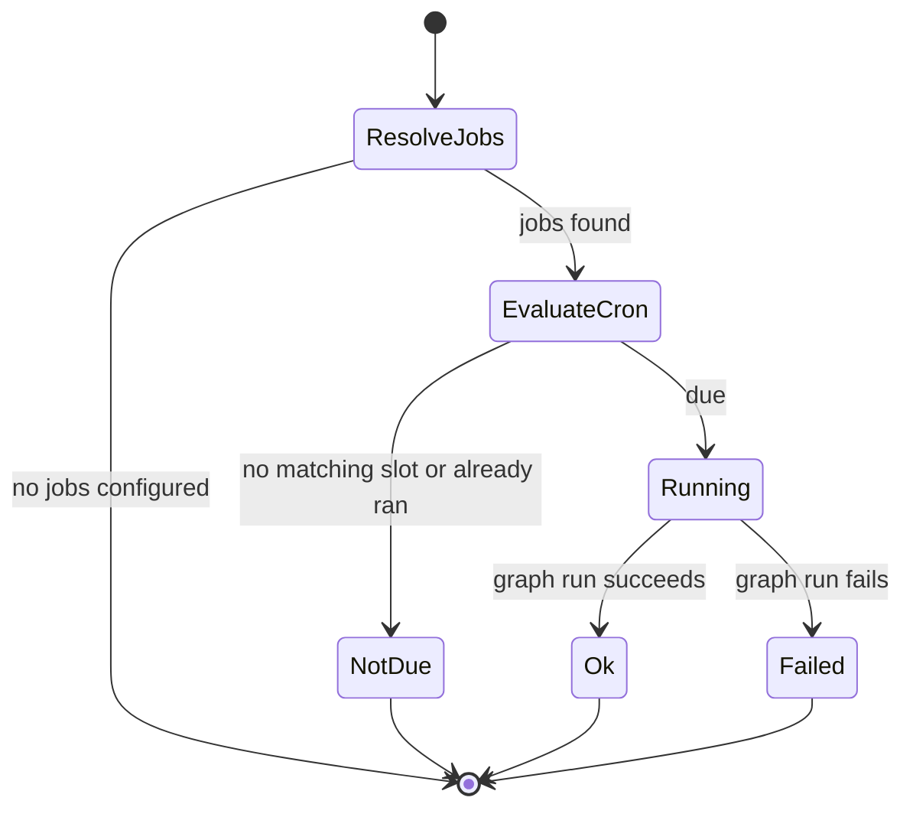

# Hatch/Mothership State Machines

This document tracks **current behavior on main** and marks planned systems explicitly.

For canonical transition/convergence semantics (edge selection precedence, fan-out/fan-in convergence, retry/terminal normalization, and composition contracts), see [Hatch Transition/Convergence Contract](./transition-convergence-contract.md).

Canonical graph sources span mothership adapter graphs plus shared capability graphs under `packages/capability-*/graphs/`.

## Legend
- **Implemented**: behavior exists in current graphs/runtime.
- **Partial**: behavior exists but with known gaps.
- **Planned**: design target (not yet implemented).

---

## System Overview

Status: **Partial**

- Goal/wave execution loops are implemented in Mothership.
- Artifact emit/ingest loop is implemented.
- Supervisor control-plane entrypoint is `factories/mothership/graphs/factory_supervisor_tick.dot`.

Operator inspection commands:
- `hatch-ops factory tick-status`
- `hatch-ops factory status --json`
- `hatch-ops factory outcomes --repo recallnet/astrochicken --lookback-hours 1 --json`

---

## Dispatch Scheduler

Status: **Partial**

Deterministic scheduling logic (implemented in `packages/factory-ops/src/commands/dispatch-scheduler.ts`) provides a stable selection order and explicit skip/requeue reasons for supervisor dispatch ticks.

What is still partial:
- global dispatch policy is still being tightened across multi-factory scenarios
- some cross-factory release/pin interactions remain under active refinement

Snapshot data requirements (per issue):
- `id` or `number`
- `state` (`OPEN`, `CLOSED`, `IN_PROGRESS`; missing => treated as OPEN and noted as `state_missing`)
- `labels` (ready gating; missing labels => not ready)
- `factory_id`
- relationships: `blocked_by`, `blocks`, `related_to` (entries with id/number + state)

Deterministic ordering (stable keys):
1) `ready_at` timestamp (ascending) if present, else numeric `priority`
2) issue number (ascending)
3) stable key `<factory_id>#<id|number>`

Concurrency policy:
- Enforce global and per-factory limits simultaneously.
- If global slots are exhausted, remaining eligible issues requeue with `global_slots_full`.
- If a factory is at capacity, its issues requeue with `factory_slots_full`.

Relationship policy:
- `blocked_by`: any OPEN/IN_PROGRESS blocker => skip `blocked_by_open`. If a `blocked_by` entry omits state, the scheduler falls back to the referenced issue snapshot state and records `blocked_by_state_missing`.
- `blocks`: non-blocking; used only to annotate `blocks_confirmed_by` on blocked issues.
- `related_to`: informational only (`related_to` note), never blocks.
- Missing relationship lists are treated as empty and surfaced via `*_missing` notes.

---

## Goal Lifecycle

Status: **Implemented**

Graphs:
- `packages/capability-goal-decomposition/workflows/goal_queue/goal_queue.workflow-source.mjs`
- `packages/capability-goal-decomposition/workflows/goal_run/goal_run.workflow-source.mjs`

Notes:
- `goal_queue` normalizes labels before processing.
- `decompose` uses bounded retry with fallback (no unbounded revise loop).

---

## Goal Execution Lifecycle

Status: **Implemented**

Graphs:
- `packages/capability-goal-decomposition/workflows/goal_run/goal_run.workflow-source.mjs`
- `factories/mothership/workflows/goal-execution/goal_execute.workflow-source.mjs` (mothership adapter)

Notes:
- Shared software-development ownership is decomposition (`goal_run`) + execution adapter (`goal_execute`) rather than mothership-local execution only.
- Goals execute sub-issues sequentially in `#`-order on a `goal/N` branch.
- The supervisor tick spawns mothership's execution adapter directly — no dispatch/lease layer.

---

## Issue Execution

Status: **Implemented**

Graphs:
- `packages/capability-coding/workflows/issue_execute_item/issue_execute_item.workflow-source.mjs` (shared issue execution contract)
- `factories/mothership/workflows/goal-execution/goal_issue_execute.workflow-source.mjs` (goal-branch adapter)

Notes:
- Shared issue execution contract lives in `issue_execute_item.workflow-source.mjs`; mothership's `goal_issue_execute.workflow-source.mjs` adapts that contract to goal-scoped branch/session context.
- Bounded deterministic review retries (`max_review_attempts`, default 3).
- There is no terminal review-fail branch inside `goal_issue_execute.workflow-source.mjs`: exhausted retries route to approved result reporting, and downstream goal split/merge handling decides follow-up actions.
- Review output may include QA fields for evidence, but approval routing is not gated on `qa.status`/`qa.command`.

---

## Merge / Judge Path

Status: **Partial**

Graphs:
- `packages/capability-merge/workflows/merge_item/merge_item.workflow-source.mjs` (shared merge contract)
- `packages/capability-release-reporting/workflows/release_report_flow/release_report_flow.workflow-source.mjs` (shared release/report handoff)
- `factories/mothership/workflows/goal-execution/goal_execute.workflow-source.mjs` (mothership adapter + post-merge goal policy)

Notes:
- Shared ownership for merge/reporting contracts is `capability-merge` + `capability-release-reporting`; mothership `goal_execute.workflow-source.mjs` composes these contracts with goal-local split/follow-up policy.
- The live flow still executes through the mothership `goal_execute.workflow-source.mjs` adapter entrypoint.

---

## Artifact Bus

Status: **Partial**

Graphs:
- `packages/capability-artifact-ingestion/workflows/artifact_ingest/artifact_ingest.workflow-source.mjs`

Implemented:
- emitter (`artifact emit-issue`), ingest (`artifact ingest`), sanitization, dedupe.

Planned:
- release propagation feedback loop (`fixed in version X`) consolidation under #203.

---

## Governance

Status: **Partial**

Sources:
- `apps/hatch/src/pipeline/validate.ts`
- `apps/hatch/src/pipeline/governance.ts`

Implemented now:
- governance identifier validation surfaces and tests.

Still in progress for #187:
- runtime evaluator + execution-time allow/deny/escalate enforcement.

---

## Scheduled Jobs (Daily Lens)

Status: **Implemented**

Sources:
- `packages/factory-ops/src/lib/daemon-schedules.ts`
- `packages/factory-ops/src/lib/daemon-scheduled-jobs.ts`
- `packages/factory-ops/src/lib/daemon-scheduled-graph-runner.ts`
- `factories/mothership/graphs/daily_lens_publish.dot`

Notes:
- Runs after every supervisor tick in the daemon loop.
- Cron evaluation is timezone-aware via `Intl.DateTimeFormat` with configurable `time_zone`.
- `catch_up: true` enables lookback (default 7 days) so missed slots fire on next tick.
- Daily Lens now runs as a scheduled Hatch graph, not a direct sidecar command.
- State is persisted to `scheduled-jobs-state.json` after each job attempt.
- Currently the only implemented job type is `graph`, with Daily Lens as the first shipped example.

---

## Docs-as-Code status for this file (#227)

Status: **Partial**

- Source-of-truth index: `docs/state-machines.sources.json`
- Deterministic checker: `node scripts/docs-check-state-machines.mjs`
- CI/pre-commit integration can be ratcheted from warning -> required gate.

---

Canonical-docs guard note: this file is part of the enforced Hatch/Mothership canonical set; unqualified legacy command/path references fail `pnpm docs:check`.

For live operations, use the canonical runbook + commands:
- `hatch validate factories/mothership/graphs/<graph>.dot`
- `hatch run factories/mothership/graphs/factory_supervisor_tick.dot`
- `hatch-ops factory tick-status`
